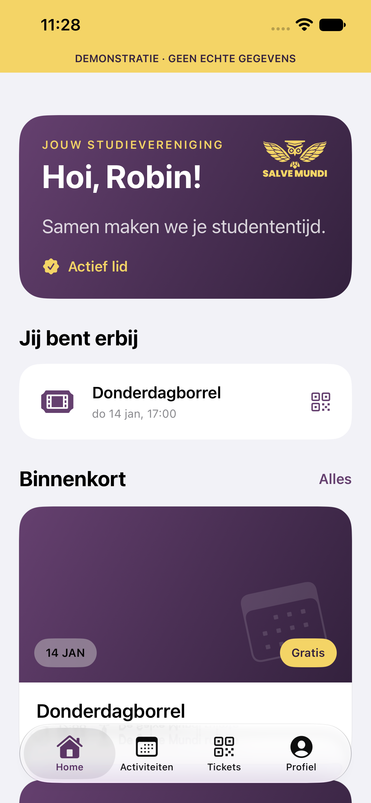

# Salve Mundi for iPhone

Native SwiftUI member app for Salve Mundi. This is an independent repository; the website remains in [salvemundi/website](https://github.com/salvemundi/website).

The first release includes activities and registration, Mollie checkout, existing QR tickets, membership/profile, event notifications and three Home Screen widgets. The interface is Dutch, with Salve Mundi branding, dark mode and accessibility support. iOS 18 or later is required.

## Run locally

1. Install Xcode, complete its first-launch setup and install an iOS simulator runtime.
2. Open `SalveMundi.xcodeproj` and select the `SalveMundi` scheme.
3. Choose an iPhone simulator and run. A device build needs your Apple Developer team configured for both app and widget targets.
4. The app uses `https://acc.salvemundi.nl` by default. The mobile backend must be installed and enabled there before live features can work. This source release does not deploy or enable that backend.

The accompanying backend work targets **acceptance only**. No production API is enabled by this repository. There is no independent app database: the server controls membership, prices, bookings, tickets and payment status.

The shared models and API client can be tested without a simulator:

```sh
swift test
```

Activity administrators can manage their authorized events from Profile. The new **Aanmeldingen activiteiten** widget shows authorized registration counts. See [activity administration](docs/activity-admin.md) and [next steps](docs/next-steps.md).

## Repository contents

- `App/`: native iPhone interface, authentication, secure local storage and Apple integrations.
- `Sources/Core/`: shared API models, networking and privacy-limited widget snapshots.
- `Widgets/`: upcoming activities and next booked event widgets.
- `Tests/`: contract, networking and widget-data tests.
- `docs/`: API contract, environment boundaries and release setup.

For an offline visual preview, add `--demo` to the Run scheme’s launch arguments in a **Debug** build. This uses synthetic data with a visible demonstration banner; it never replaces live server responses.



See [architecture](docs/architecture.md), [API contract](docs/openapi.json) and [release setup](docs/release.md). Never commit member data, database credentials, Apple keys or signing files.
